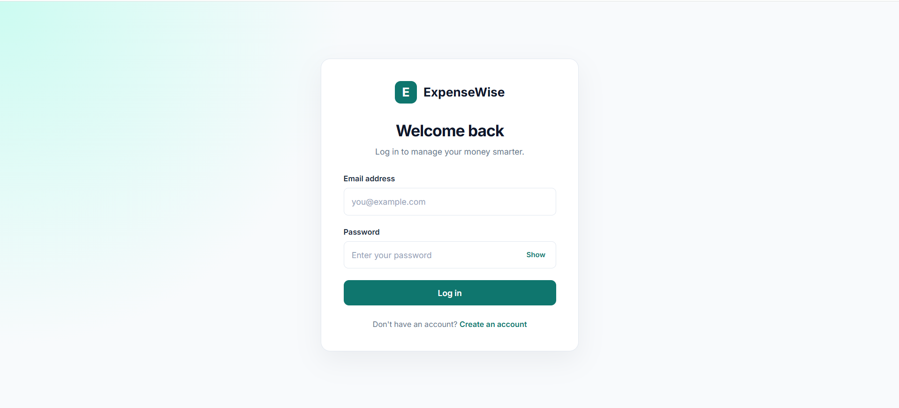
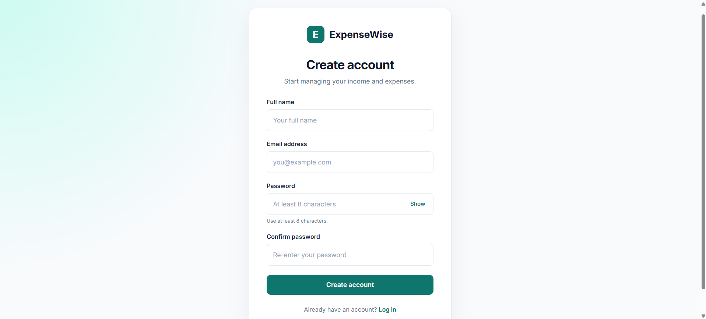
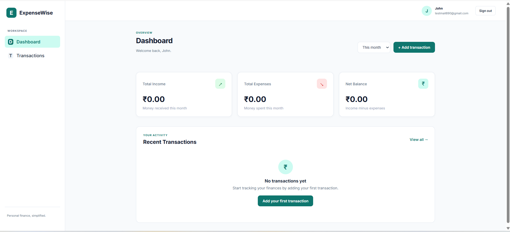
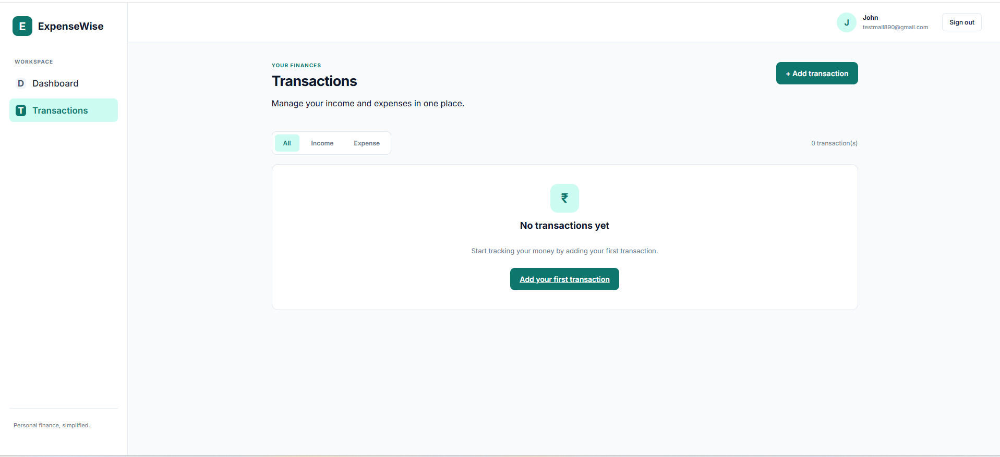
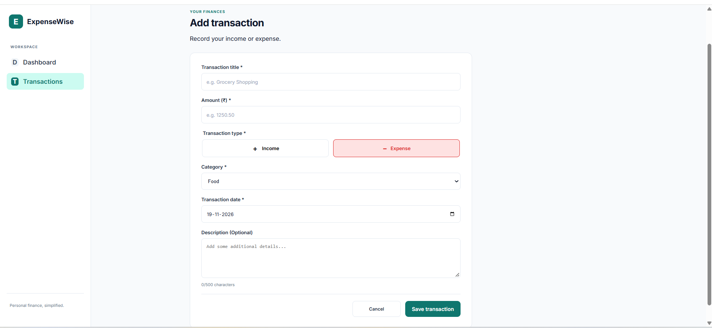

# ExpenseWise – Personal Expense Tracker

**Track your money. Understand your spending. Stay in control.**

ExpenseWise is a full-stack personal finance application that helps users manage their income and expenses through a clean, responsive interface. Users can record transactions, organize them into predefined categories, monitor their monthly financial summaries, and review their transaction history.

Built with React, Node.js, Express.js and MongoDB Atlas, ExpenseWise demonstrates full-stack development, REST API design, authentication, database integration and cloud deployment.

### Live Application

**[Open ExpenseWise](https://expensewise-voidsyntax890.vercel.app/)**

**[GitHub Repository](https://github.com/voidsyntax890/ExpenseWise)**

---

## Screenshots

### Login and Registration

| Login | Registration |
|---|---|
|  |  |

### Dashboard



### Transaction Management



### Add Transaction



---

## Features

### Authentication and Security
- User registration and login.
- Password hashing using bcryptjs.
- JWT-based authentication.
- JWT stored in an HttpOnly cookie.
- Secure cookie configuration in production.
- Session restoration after browser refresh.
- Protected application routes.
- User-specific transaction access.
- Server-side request validation and origin checking.
- Rate limiting for registration and login.

### Transaction Management
- Create income and expense transactions.
- View transaction history.
- Edit existing transactions.
- Delete transactions with confirmation.
- Filter transactions by All, Income and Expense.
- Predefined categories.
- User-selected transaction dates.
- Optional transaction descriptions.
- Form validation and error feedback.

### Financial Dashboard
- Total Income for the current month.
- Total Expenses for the current month.
- Net Balance calculation.
- Recent transactions.
- Add Transaction shortcut.
- View All Transactions navigation.

### Responsive Interface
- Desktop sidebar navigation.
- Compact tablet navigation.
- Mobile bottom navigation.
- Responsive transaction cards.
- Mobile-friendly transaction forms.
- Responsive dashboard summary cards.

---

## Technology Stack

| Layer | Technology |
|---|---|
| Frontend | React |
| Build Tool | Vite |
| Language | JavaScript |
| Routing | React Router DOM |
| HTTP Client | Axios |
| State Management | React Context API |
| Styling | CSS |
| Backend | Node.js |
| API Framework | Express.js |
| Database | MongoDB Atlas |
| ODM | Mongoose |
| Authentication | JSON Web Token |
| Password Hashing | bcryptjs |
| Request Validation | express-validator |
| Security Headers | Helmet |
| Rate Limiting | express-rate-limit |
| Frontend Hosting | Vercel |
| Backend Hosting | Render |
| Version Control | Git and GitHub |

---

## Architecture

ExpenseWise uses a modular monolithic backend architecture with a separate React frontend.

```text
                  USER
                   |
                   v
             VERCEL HOSTING
             React + Vite
                   |
                   |
              /api requests
                   |
                   v
             VERCEL REWRITE
                   |
                   v
             RENDER HOSTING
           Node.js + Express
                   |
                   v
           Authentication and
            Validation Layer
                   |
                   v
             Controllers
                   |
                   v
          Mongoose Data Models
                   |
                   v
            MONGODB ATLAS
             Users Database
          Transactions Database
```

### Request Flow

1. The user interacts with the React frontend.
2. Axios sends requests through the same-origin `/api` path.
3. Vercel forwards API requests to the Render backend.
4. Express processes the request through the appropriate middleware and route.
5. Authentication middleware verifies the JWT cookie for protected endpoints.
6. Controllers perform the required business operations.
7. Mongoose communicates with MongoDB Atlas.
8. The backend returns a JSON response.
9. React updates the interface based on the response.

---

## Financial Data Handling

ExpenseWise stores transaction amounts as integer paise to avoid floating-point precision issues.

For example:

| User Input | Database Storage |
|---|---:|
| ₹100 | 10,000 paise |
| ₹250.50 | 25,050 paise |
| ₹1,250.75 | 125,075 paise |

The API accepts amounts in rupees and converts them into paise before database storage.

The frontend displays amounts using the Indian Rupee (INR) format.

### Dashboard Calculation

Net Balance is calculated as:

**Net Balance = Total Income − Total Expenses**

The financial summary is calculated on the backend using MongoDB aggregation and is scoped to the authenticated user.

Only transactions within the current calendar month are included in the monthly summary.

---

## API Endpoints

All endpoints return JSON responses.

### Health Check

| Method | Endpoint | Authentication |
|---|---|---|
| GET | `/api/health` | No |

### Authentication

| Method | Endpoint | Purpose |
|---|---|---|
| POST | `/api/auth/register` | Register a user |
| POST | `/api/auth/login` | Authenticate a user |
| POST | `/api/auth/logout` | End the session |
| GET | `/api/auth/me` | Retrieve the authenticated user |

### Transactions

| Method | Endpoint | Purpose |
|---|---|---|
| GET | `/api/transactions` | Retrieve transactions |
| POST | `/api/transactions` | Create a transaction |
| GET | `/api/transactions/:id` | Retrieve one transaction |
| PUT | `/api/transactions/:id` | Update a transaction |
| DELETE | `/api/transactions/:id` | Delete a transaction |
| GET | `/api/transactions/summary` | Retrieve monthly financial summary |

The transaction list supports the basic type filter:

```http
GET /api/transactions?type=all
GET /api/transactions?type=income
GET /api/transactions?type=expense
```

Transaction endpoints are protected by authentication middleware. The authenticated user ID is obtained from the verified JWT rather than trusting a user ID submitted by the client.

---

## Project Structure

```text
ExpenseWise/
│
├── backend/
│   ├── config/
│   │   ├── auth.js
│   │   └── db.js
│   │
│   ├── constants/
│   │
│   ├── controllers/
│   │   ├── authController.js
│   │   └── transactionController.js
│   │
│   ├── middleware/
│   │   ├── authMiddleware.js
│   │   ├── errorMiddleware.js
│   │   ├── originMiddleware.js
│   │   └── validateRequest.js
│   │
│   ├── models/
│   │   ├── User.js
│   │   └── Transaction.js
│   │
│   ├── routes/
│   │   ├── authRoutes.js
│   │   └── transactionRoutes.js
│   │
│   ├── scripts/
│   ├── utils/
│   ├── .env.example
│   ├── package.json
│   └── server.js
│
├── frontend/
│   ├── public/
│   ├── src/
│   │   ├── assets/
│   │   ├── components/
│   │   ├── constants/
│   │   ├── context/
│   │   ├── pages/
│   │   ├── services/
│   │   ├── utils/
│   │   ├── App.jsx
│   │   ├── App.css
│   │   └── index.css
│   │
│   ├── vercel.json
│   ├── package.json
│   └── vite.config.js
│
├── .gitignore
└── README.md
```

---

## Local Installation and Setup

Follow these steps to run ExpenseWise on your local machine.

### Prerequisites

- Node.js and npm
- Git
- MongoDB Atlas account or an accessible MongoDB deployment
- Visual Studio Code (recommended)

### 1. Clone the Repository

```bash
git clone https://github.com/voidsyntax890/ExpenseWise.git
```

Navigate into the project directory:

```bash
cd ExpenseWise
```

### 2. Configure the Backend

Navigate to the backend:

```bash
cd backend
```

Install dependencies:

```bash
npm install
```

Create a local environment file.

PowerShell:

```powershell
Copy-Item .env.example .env
```

Open `backend/.env` and configure your local development values:

```env
PORT=5000
NODE_ENV=development

MONGO_URI=your_development_mongodb_connection_string

JWT_SECRET=your_long_random_development_secret

CLIENT_URL=http://localhost:5173
```

Use your own MongoDB development database URI and a strong JWT secret of at least 32 characters.

Start the backend:

```bash
npm run dev
```

The backend will run on:

```text
http://localhost:5000
```

Test the health endpoint:

```text
http://localhost:5000/api/health
```

### 3. Configure the Frontend

Open another terminal and navigate to the frontend:

```bash
cd ExpenseWise/frontend
```

Install dependencies:

```bash
npm install
```

Start the Vite development server:

```bash
npm run dev
```

Open:

```text
http://localhost:5173
```

The frontend communicates with the backend through `/api`, which Vite proxies to the local Express server.

---

## Environment Variables

### Backend

The following environment variables are required by the backend.

| Variable | Purpose |
|---|---|
| `PORT` | Backend server port |
| `NODE_ENV` | Application environment |
| `MONGO_URI` | MongoDB connection string |
| `JWT_SECRET` | JWT signing and verification secret |
| `CLIENT_URL` | Allowed frontend origin |

### Production Environment

The deployed backend uses Render environment variables.

| Variable | Production Configuration |
|---|---|
| `NODE_ENV` | `production` |
| `MONGO_URI` | Production MongoDB Atlas URI |
| `JWT_SECRET` | Separate production secret |
| `CLIENT_URL` | Production Vercel domain |
| `PORT` | Supplied automatically by Render |

The frontend does not require private environment variables because it communicates through `/api`.

**Security:** Never commit `.env` files or expose MongoDB connection strings, JWT secrets, passwords or authentication tokens. Anything prefixed with `VITE_` is exposed to the browser and must not contain private secrets.

---

## Deployment

ExpenseWise is deployed using the following services:

| Component | Platform |
|---|---|
| Frontend | Vercel |
| Backend | Render |
| Database | MongoDB Atlas |
| Source Code | GitHub |

### Live URLs

**Frontend**

https://expensewise-voidsyntax890.vercel.app/

**Backend**

https://expensewise-api-3dp5.onrender.com/

**Health Check**

https://expensewise-api-3dp5.onrender.com/api/health

### Production API Proxy

The Vercel configuration in `frontend/vercel.json` forwards `/api` requests to the Render backend.

This maintains the same-origin request architecture used by the application's HttpOnly authentication cookie.

---

## Security Implementation

ExpenseWise includes the following security measures:

- Password hashing using bcryptjs.
- JWT authentication.
- HttpOnly authentication cookies.
- Secure cookies in production.
- SameSite=Lax cookie policy.
- Server-side request validation.
- User-scoped database queries.
- Protection against cross-user transaction access.
- Origin validation for state-changing requests.
- Rate limiting for registration and login.
- Helmet security headers.
- Generic production error responses.
- Environment-based secret management.

The application does not store JWT credentials in Local Storage or Session Storage.

---

## Testing and Quality Assurance

The project was tested locally and after production deployment.

### Backend Testing

- Registration and login APIs.
- Authentication and session restoration.
- Transaction CRUD operations.
- Request validation.
- Invalid transaction handling.
- Transaction ownership checks.
- Financial summary calculations.
- Negative net balance handling.

### Frontend Testing

- Login and registration.
- Add, edit and delete transaction workflows.
- Transaction filters.
- Dashboard calculations.
- Loading and error states.
- Responsive layouts.
- Mobile navigation.
- Keyboard navigation.
- API failure handling.

### Production Testing

- Live registration and login.
- HttpOnly authentication cookie verification.
- Session restoration after refresh.
- Production transaction creation, editing and deletion.
- Database persistence after refresh.
- Dashboard calculation verification.
- Unauthenticated API access rejection.
- Cross-user data isolation.
- Direct transaction ID ownership protection.
- Mobile and desktop application testing.

---

## Known Limitations

ExpenseWise is an MVP and portfolio demonstration project.

The current release intentionally does not include:

- Financial charts and analytics.
- Budget management.
- Recurring transactions.
- CSV/PDF exports.
- Custom category management.
- Multiple currencies.
- Banking integrations.
- Receipt scanning.

The backend currently uses Render's Free instance. It can spin down after inactivity, so the first request after a period without traffic may take longer to complete.

MongoDB Atlas stores application data independently of the Render service.

---

## Future Improvements

Potential future enhancements include:

- Monthly and category-based financial analytics.
- Budget tracking.
- Recurring expenses.
- Transaction search.
- Export functionality.
- Additional reporting features.

These are future enhancements and are not part of the current MVP.

---

## Author

**Anirban Bhattacharyya**

GitHub: [voidsyntax890](https://github.com/voidsyntax890)

Project Repository: [ExpenseWise](https://github.com/voidsyntax890/ExpenseWise)

---

## Disclaimer

ExpenseWise is an educational and portfolio demonstration project.

It is not a banking application or financial institution. Do not enter banking credentials, payment information or other sensitive financial account details.